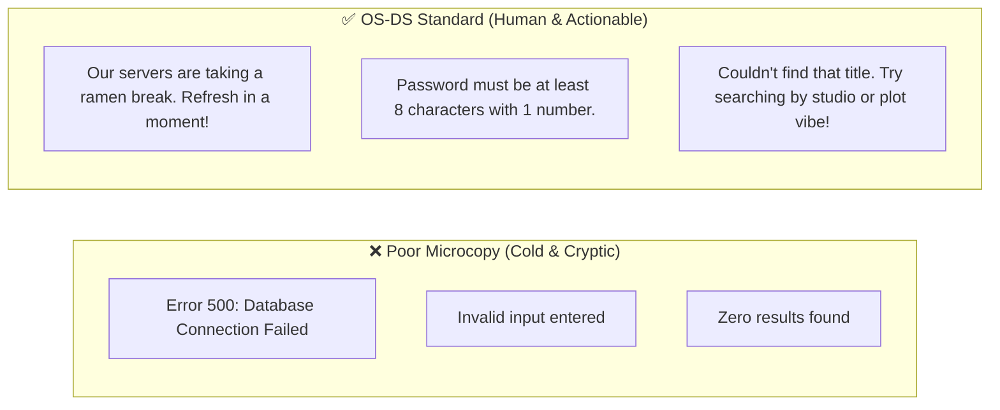
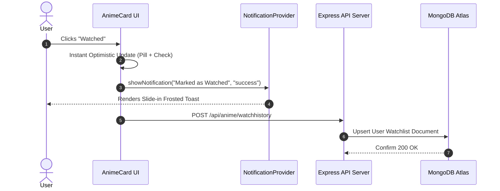
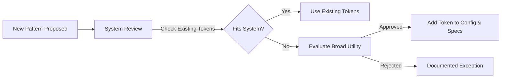

# 🌸 OtakuCircle Design System Specification (OS-DS)
> **Version:** 2.5.0  
> **Status:** Production Standard  
> **Target Platform:** Social Anime Discovery Platform (Web, Responsive Mobile & Desktop)  
> **Repository:** [OtakuCircle](file:///c:/Users/khush/Documents/Projects/OtakuCircle)

---

## 📑 Table of Contents
1. [Brand Identity, Principles & Tone](#1-brand-identity-principles--tone)
   - [1.1 Product Vision & 5 Core Design Principles](#11-product-vision--5-core-design-principles)
   - [1.2 Voice & Tone Matrix](#12-voice--tone-matrix)
   - [1.3 UX Microcopy & Error State Guidelines](#13-ux-microcopy--error-state-guidelines)
2. [Design Tokens & Foundations](#2-design-tokens--foundations)
   - [2.1 Token Architecture & Semantic Naming](#21-token-architecture--semantic-naming)
   - [2.2 Color System (60-30-10 Dark Canvas)](#22-color-system-60-30-10-dark-canvas)
   - [2.3 Surface Glassmorphism & Translucency](#23-surface-glassmorphism--translucency)
   - [2.4 Typography Scale & Hierarchy (Outfit)](#24-typography-scale--hierarchy-outfit)
   - [2.5 Spatial System & 8pt Grid](#25-spatial-system--8pt-grid)
   - [2.6 Elevation, Shadows & Atmospheric Glow](#26-elevation-shadows--atmospheric-glow)
   - [2.7 Border Radii & Shape Language](#27-border-radii--shape-language)
   - [2.8 Iconography & Visual Metaphors](#28-iconography--visual-metaphors)
   - [2.9 Motion, Physics & Micro-Interactions](#29-motion-physics--micro-interactions)
3. [Component Library](#3-component-library)
   - [3.1 Atoms (Buttons, Inputs, Badges, Avatars)](#31-atoms)
   - [3.2 Molecules (WatchStatusDropdown, Toast, Live Search, Stat Counter)](#32-molecules)
   - [3.3 Organisms (AnimeCard, AnimeSection, Navbar, SpotlightHero, Modals, Radar)](#33-organisms)
4. [Pattern Library & Complex UX Layouts](#4-pattern-library--complex-ux-layouts)
   - [4.1 1-Click Cataloging & State Transition Pattern](#41-1-click-cataloging--state-transition-pattern)
   - [4.2 AI Semantic Vibe Search & Discovery Flow](#42-ai-semantic-vibe-search--discovery-flow)
   - [4.3 Peer Recommendation & Social Notification Flow](#43-peer-recommendation--social-notification-flow)
   - [4.4 Empty States & Edge Cases](#44-empty-states--edge-cases)
   - [4.5 Responsive Layout Strategy & Mobile Drawer Templates](#45-responsive-layout-strategy--mobile-drawer-templates)
5. [Accessibility & Inclusivity Guidelines (WCAG 2.1 AA)](#5-accessibility--inclusivity-guidelines-wcag-21-aa)
   - [5.1 Contrast Standards](#51-contrast-standards)
   - [5.2 Keyboard Navigation & Focus Visible](#52-keyboard-navigation--focus-visible)
   - [5.3 Screen Reader Support (ARIA)](#53-screen-reader-support-aria)
   - [5.4 Reduced Motion Support](#54-reduced-motion-support)
6. [Design-to-Code Architecture & Implementation](#6-design-to-code-architecture--implementation)
   - [6.1 Tailwind Configuration Integration](#61-tailwind-configuration-integration)
   - [6.2 The "No Hardcoded Magic Numbers" Code Policy](#62-the-no-hardcoded-magic-numbers-code-policy)
   - [6.3 Contribution Lifecycle & Exception Rules](#63-contribution-lifecycle--exception-rules)
   - [6.4 Machine Context & UI Coding Directives](#64-machine-context--ui-coding-directives)

---

## 1. Brand Identity, Principles & Tone

### 1.1 Product Vision & 5 Core Design Principles

#### 🌟 1. Cinematic & Immersive (The Theater Principle)
Anime is a vibrant visual medium. The interface functions like a premium cinema: deep obsidian backdrops (`#050505` to `#0d0d0d`) with ambient glow and frosted glass that make cover art and studio animation pop without visual competition.

#### ⚡ 2. Frictionless & Glanceable (Speed of Thought)
Cataloging dozens of episodes or switching watch status must never require page refreshes. Every interaction is lightweight, optimistic, and accompanied by immediate feedback.

#### 🧠 3. Ambient Intelligence (AI Harmony)
OtakuCircle’s cosine similarity recommendation engine operates quietly in the background. The UI surfaces ML insights naturally—through dynamic "vibe" search matches and taste radar charts.

#### 🤝 4. Community Warmth (Social Connection)
Unlike sterile databases, OtakuCircle celebrates fandom camaraderie: direct peer recommendations, watch activity synchronization, and celebration badges.

#### 🧩 5. Strict Token Compliance (No Magic Values)
No arbitrary hex colors, ad-hoc paddings, or rogue border radii are permitted in production code. If a value isn't a defined token, it requires an approved design system exception.

---

### 1.2 Voice & Tone Matrix

| Dimension | Scale (1 to 5) | OtakuCircle Standard | Practical Application |
| :--- | :---: | :--- | :--- |
| **Funny vs. Serious** | 3.5 | **Witty & Playful** | Warm anime references (e.g. "Over 9000 hours tracked!") without descending into incomprehensible jargon. |
| **Formal vs. Casual** | 4.2 | **Casual & Conversational** | "Add to your queue" rather than "Submit record to database". |
| **Respectful vs. Irreverent** | 2.0 | **Respectful & Supportive** | Celebrates diverse tastes without elitism; avoids gatekeeping. |
| **Enthusiastic vs. Matter-of-Fact** | 4.0 | **Enthusiastic & Passionate** | Welcomes users to new seasons with excitement and energy. |

---

### 1.3 UX Microcopy & Error State Guidelines



* **Affirmations & Feedback:** Immediate, positive feedback for high-frequency actions (e.g., *"Added to your Watchlist!"*, *"Marked as Watched! Enjoy the finale."*).
* **Destructive Confirmations:** Explicit, transparent wording (e.g., *"Remove Death Note from your watch history? Your ratings and notes for this title will be deleted."*).

---

## 2. Design Tokens & Foundations

### 2.1 Token Architecture & Semantic Naming

All tokens follow a 3-tier hierarchy:
1. **Global / Primitive Tokens:** Raw values (`color-blue-500: #3b82f6`).
2. **Contextual / Semantic Tokens:** Purpose-bound tokens (`color-status-watching: {color-blue-500}`).
3. **Component Scoped Tokens:** Bound to individual component slots (`watch-dropdown-bg: {color-surface-raised}`).

---

### 2.2 Color System (60-30-10 Dark Canvas)

OtakuCircle enforces a **60-30-10 dark canvas distribution**:
* **60% Dominant Base:** Deep obsidian, void canvas, and darkened cinematic neutral backdrops.
* **30% Structural Secondary:** Frosted glass panels, elevated card surfaces, translucent navigation bars, and typography.
* **10% Semantic & Emotional Accents:** Score yellows, status blues and greens, social purples, and high-contrast white CTAs.

#### Complete Token Palette & Contrast Audits
| Token Identifier | Hex / RGBA Value | Tailwind Class Equivalent | Purpose & Role | Contrast Ratio on Canvas |
| :--- | :--- | :--- | :--- | :---: |
| `color-canvas-deep` | `#050505` | `bg-[#050505]` | Core floor backdrop & fixed navigation scrim | — |
| `color-canvas-base` | `#0a0a0a` | `bg-[#0a0a0a]` | Secondary page backdrop & poster shadow blend | — |
| `color-surface-base` | `#0d0d0d` | `bg-[#0d0d0d]` | Main page content container & section wrappers | — |
| `color-surface-raised`| `#141414` | `bg-[#141414]` | Flyout modals, menus, and context popovers | 1.15:1 vs base |
| `color-surface-card` | `rgba(255,255,255,0.05)` | `bg-white/5` | Unhovered poster card background | — |
| `color-brand-primary` | `#ffffff` | `bg-white text-black` | Primary action buttons, headline typography | **19.8:1 (AAA)** |
| `color-brand-secondary`| `#e4e4e7` (Zinc-200) | `text-zinc-200` | Subheadings, high-priority navigation links | **15.2:1 (AAA)** |
| `color-text-muted` | `#a1a1aa` (Zinc-400) | `text-zinc-400` | Metadata, tags, runtime, release year | **6.8:1 (AA)** |
| `color-text-faint` | `#71717a` (Zinc-500) | `text-zinc-500` | Inactive icons, subtle captions | **4.6:1 (AA)** |
| `color-status-watching`| `#60a5fa` (Blue-400) | `text-blue-400 bg-blue-500/10` | In-progress anime tracking badge | **8.2:1 (AAA)** |
| `color-status-watched` | `#4ade80` (Green-400) | `text-green-400 bg-green-500/10`| Completed / watched checkmark & pill | **9.5:1 (AAA)** |
| `color-rating-gold` | `#facc15` (Yellow-400) | `text-yellow-400 bg-yellow-400/10`| Star rating badge, Otaku Legend crown | **12.1:1 (AAA)** |
| `color-social-accent` | `#c084fc` (Purple-400) | `text-purple-400 bg-purple-500/10`| Friend recommendation action button | **7.4:1 (AA)** |
| `color-feedback-danger`| `#f87171` (Red-400) | `text-red-400 bg-red-500/10` | Destructive actions, delete confirms | **7.1:1 (AA)** |

---

### 2.3 Surface Glassmorphism & Translucency

Three standardized frosted glass tokens deliver physical depth over dynamic poster backgrounds:

```css
/* Glass Surface Tokens */
:root {
  --glass-subtle: rgba(255, 255, 255, 0.05) backdrop-filter: blur(12px) border: 1px solid rgba(255, 255, 255, 0.08);
  --glass-medium: rgba(10, 10, 10, 0.60) backdrop-filter: blur(20px) border: 1px solid rgba(255, 255, 255, 0.10);
  --glass-heavy: rgba(5, 5, 5, 0.85) backdrop-filter: blur(32px) border: 1px solid rgba(255, 255, 255, 0.15);
}
```

* **Subtle Glass (`bg-white/5 backdrop-blur-md border border-white/10`):** Used on inner poster buttons, watchlist toggles, and metadata tags.
* **Medium Glass (`bg-black/60 backdrop-blur-xl border border-white/10`):** Used on notification toasts, navigation scroll states, and search input bars.
* **Heavy Glass (`bg-[#0a0a0a]/90 backdrop-blur-2xl border border-white/15`):** Used on flyout modals, friend profile cards, and dropdown popovers.

---

### 2.4 Typography Scale & Hierarchy (Outfit)

The official font family is **Outfit** (imported via Google Fonts in [`client/src/index.css`](file:///c:/Users/khush/Documents/Projects/OtakuCircle/client/src/index.css#L2)):

```css
font-family: 'Outfit', -apple-system, BlinkMacSystemFont, 'Segoe UI', Roboto, sans-serif;
```

#### The Modular Type Scale
| Level | Font Size (px / rem) | Line Height | Weight | Tracking | Applied Components |
| :--- | :--- | :--- | :--- | :--- | :--- |
| **Hero Display** | 144px / 9.0rem | 1.00 | Extrabold (800) | `-0.05em` | Spotlight hero title (`Home.jsx`) |
| **Display 2** | 72px / 4.5rem | 1.05 | Extrabold (800) | `-0.04em` | Landing header on mobile/tablet |
| **Heading 1** | 48px / 3.0rem | 1.15 | Black (900) | `-0.03em` | Detail page titles (`AnimeDetails.jsx`) |
| **Heading 2** | 32px / 2.0rem | 1.25 | Bold (700) | `-0.02em` | Section titles ("Trending Now", "AI Recs") |
| **Heading 3** | 24px / 1.5rem | 1.30 | Bold (700) | `-0.01em` | Modal titles, stat summary headers |
| **Heading 4** | 20px / 1.25rem | 1.35 | SemiBold (600) | `0em` | Card titles, friend username labels |
| **Body Large** | 18px / 1.125rem| 1.50 | Medium (500) | `+0.01em` | Spotlight tagline, synopsis lead |
| **Body Regular** | 16px / 1.0rem | 1.55 | Regular (400) | `0em` | Synopsis text, bio descriptions, modal bodies |
| **Body Small** | 14px / 0.875rem| 1.45 | Medium (500) | `+0.01em` | Navigation items, dropdown option items |
| **Caption / Meta** | 12px / 0.75rem | 1.30 | SemiBold (600) | `+0.04em` | Score badges, release years, episode tags |
| **Overline Micro** | 11px / 0.6875rem| 1.20 | Bold (700) | `+0.08em` | Uppercase category pills, TV/Movie tags |

---

### 2.5 Spatial System & 8pt Grid

OS-DS uses an **8-point spatial base** (with a 4-point micro-step for compact pills, chips, and badges). All margins, paddings, gutters, and dimensions derive from this scale:

| Token | Dimension (px) | Dimension (rem) | Usage Guideline |
| :--- | :--- | :--- | :--- |
| `space-1` | 4px | 0.25rem | Micro inline padding, badge vertical offset, icon gap |
| `space-2` | 8px | 0.50rem | Chip padding, small button inline gap, input vertical |
| `space-3` | 12px | 0.75rem | Dropdown item padding, compact card margins |
| `space-4` | 16px | 1.00rem | Standard button padding, card body gutters, mobile margins |
| `space-6` | 24px | 1.50rem | Carousel card horizontal gap (`flex gap-6`), modal internal padding |
| `space-8` | 32px | 2.00rem | Section margin bottom, desktop card gutter |
| `space-12`| 48px | 3.00rem | Section vertical separation (`mb-16 scroll-mt-32`) |
| `space-16`| 64px | 4.00rem | Major page section padding, hero top margin offset |
| `space-20`| 80px | 5.00rem | Navigation bar height (`h-20`), header clearances |

---

### 2.6 Elevation, Shadows & Atmospheric Glow

Elevation on a dark canvas is communicated through **atmospheric light emissions and luminescence**:

| Elevation Level | Token / CSS Rule | Visual Description |
| :--- | :--- | :--- |
| **Level 0 (Flat)** | `box-shadow: none;` | Floor background and inline text |
| **Level 1 (Subtle Rim)** | `border: 1px solid rgba(255,255,255,0.08);` | Content sections, inactive cards, subtle inputs |
| **Level 2 (Float)** | `box-shadow: 0 10px 30px -10px rgba(0,0,0,0.8);` | Hovered dropdowns, context popovers |
| **Level 3 (Modal Scrim)** | `box-shadow: 0 25px 50px -12px rgba(0,0,0,0.95);` | Centered dialogs, search modal results |
| **Atmospheric Glow** | `box-shadow: 0 0 40px -10px rgba(255,255,255,0.25);` | Hovered Anime Card poster highlight |
| **Brand Glow (Blue)**| `box-shadow: 0 0 20px 0 rgba(59,130,246,0.30);` | Focused inputs, active watchlist buttons |
| **Success Glow** | `box-shadow: 0 0 20px 0 rgba(34,197,94,0.25);` | "Watched" confirmed status |

---

### 2.7 Border Radii & Shape Language

```css
--radius-sm:   6px;   /* Micro badges, nested elements */
--radius-md:   8px;   /* Rating tags, genre chips, icon buttons */
--radius-lg:   12px;  /* Text inputs, small modals, dropdown popovers */
--radius-xl:   16px;  /* Anime cards, dialog sheets, media previews */
--radius-2xl:  24px;  /* Large hero banners, floating search bar */
--radius-full: 9999px;/* CTA Buttons, circular avatars, status pills */
```

---

### 2.8 Iconography & Visual Metaphors

All icons are rendered using [lucide-react](file:///c:/Users/khush/Documents/Projects/OtakuCircle/client/package.json) with standardized dimensions:
* **Micro (14px, stroke 2.5):** Dropdown carets, checkmarks within pills, star ratings (`Star`, `ChevronDown`, `Check`).
* **Standard (16px to 18px, stroke 2.0):** Form input indicators, button actions (`Plus`, `Lock`, `Mail`, `Share2`, `Play`).
* **Section / Action (20px to 24px, stroke 2.0):** Navigation items, toast notification status (`Bell`, `Search`, `Users`, `CheckCircle`).
* **Hero / Feature (32px to 48px, stroke 1.5):** Empty states, award trophies, category banners.

---

### 2.9 Motion, Physics & Micro-Interactions

* **GPU Acceleration:** High-frequency elements must specify `transform-gpu backface-hidden will-change-transform`.
* **Timing Curves:** Default curve is `cubic-bezier(0.16, 1, 0.3, 1)` (snappy ease-out with soft settle).
* **Hover Scale Tokens:**
  * Interactive Cards: `hover:scale-105 active:scale-98` (duration 500ms).
  * CTA Buttons: `hover:scale-105 active:scale-95` (duration 200ms).
  * Inner Image Zoom: `group-hover:scale-110` (duration 700ms).

---

## 3. Component Library

### 3.1 Atoms

#### Button System
The primary action driver across OtakuCircle interfaces.

##### Variants
1. **Primary Solid White (CTA):**
   - *Purpose:* Top-level conversions ("Sign In", "Explore Catalog", "Watch Trailer").
   - *Code:* `bg-white text-black font-bold py-3.5 px-6 rounded-full hover:bg-zinc-200 transition-all active:scale-95 shadow-lg`
2. **Glass Frosted Secondary:**
   - *Purpose:* Secondary actions within cards and headers ("+ Watchlist", "Filter").
   - *Code:* `bg-white/10 hover:bg-white/20 border border-white/20 text-white font-bold py-2.5 px-5 rounded-full backdrop-blur-sm transition-all active:scale-95`
3. **Ghost Action / Icon Button:**
   - *Purpose:* Navigation buttons, carousel controls, modal dismiss.
   - *Code:* `p-3 rounded-full bg-black/50 hover:bg-white hover:text-black border border-white/10 text-white transition-all duration-300 shadow-2xl`
4. **Destructive / Danger:**
   - *Purpose:* Removing anime from list, cancelling request.
   - *Code:* `bg-red-500/10 hover:bg-red-500/20 text-red-400 border border-red-500/30 font-bold py-2 px-4 rounded-xl transition-all`

##### Button States Table
| State | Visual Treatment | Code Attributes |
| :--- | :--- | :--- |
| **Default** | Full opacity, intended variant background | `cursor-pointer opacity-100` |
| **Hover** | Lift scale (+2% to +5%), background brightness increase | `hover:scale-105 hover:bg-opacity-90` |
| **Active / Pressed**| Compression scale (-3% to -5%) for tactile bounce | `active:scale-95` |
| **Focus-Visible** | 2px electric blue glow ring with 2px offset | `focus-visible:ring-2 focus-visible:ring-blue-500/50` |
| **Disabled** | Muted opacity (40%), cursor not allowed, no scale | `disabled:opacity-40 disabled:cursor-not-allowed` |
| **Loading** | Spinner replaces text icon, click event swallowed | `aria-busy="true" <Loader className="animate-spin" />` |

##### Button Rules
* ✅ Limit to a single primary white CTA per viewport to maintain visual hierarchy.
* ✅ Always pair icons with accessible text or provide an `aria-label`.
* ❌ Never use arbitrary saturated reds or blues for generic buttons.
* ❌ Never remove tactile active scale feedback (`active:scale-95`).

---

#### Form Controls
Text inputs and search fields configured for dark-mode focus states.

```jsx
<div className="relative group w-full">
  <div className="absolute inset-y-0 left-0 pl-3.5 flex items-center pointer-events-none text-zinc-400 group-focus-within:text-white transition-colors">
    <Search size={18} />
  </div>
  <input
    type="text"
    className="block w-full pl-10 pr-4 py-3 bg-white/5 border border-white/10 rounded-xl text-white placeholder-zinc-500 text-sm focus:outline-none focus:ring-2 focus:ring-blue-500/50 focus:border-blue-500/50 transition-all duration-300 shadow-[inset_0_2px_4px_rgba(0,0,0,0.3)]"
    placeholder="Search anime, studios, genres..."
  />
</div>
```

---

#### Badges, Scores & Chips
Compact indicators for ratings, status, format, and genre tags.

* **Rating Badge (★ 8.92):** `bg-yellow-500/10 text-yellow-400 border border-yellow-500/20 px-2.5 py-1 rounded-lg text-xs font-black backdrop-blur-md flex items-center gap-1`
* **Media Type Pill (TV / MOVIE / OVA):** `bg-white/10 text-white border border-white/10 px-2 py-0.5 rounded-md text-[10px] font-bold tracking-widest uppercase`
* **Genre Chip (Action, Shounen):** `bg-white/5 hover:bg-white/10 text-zinc-300 border border-white/10 px-3 py-1 rounded-full text-xs font-medium transition-colors`
* **Status Pill (Watching / Watched):** `bg-blue-500/20 text-blue-400 border border-blue-500/30 px-3 py-1 rounded-full text-xs font-bold`

---

#### Avatars & Identity Indicators
* **Dimensions:** 32px (Navbar), 48px (Friends List), 96px (Profile Header).
* **Shape:** `rounded-full border-2 border-white/10 overflow-hidden bg-zinc-900`.
* **Fallback:** Centered `<User className="text-zinc-500" />` with gradient background.

---

### 3.2 Molecules

#### WatchStatusDropdown Molecule
Enables users to toggle anime between *Watching* and *Watched* with optimistic updates.
* **Component Path:** [`client/src/components/WatchStatusDropdown.jsx`](file:///c:/Users/khush/Documents/Projects/OtakuCircle/client/src/components/WatchStatusDropdown.jsx)
* **Features:**
  * Outside click dismiss (`mousedown` listener on document).
  * Dynamic flyout direction (`direction="up"` or `"down"`).
  * Instant visual confirmation with checkmark badge transition.

```jsx
const displayText = isAdded ? "Added" : (currentStatus || "Watch Status");

<button 
  disabled={disabled}
  className={`w-full flex items-center justify-between gap-1.5 py-2 px-4 rounded-xl text-xs font-bold backdrop-blur-sm transition-all shadow-lg border outline-none ${
    disabled 
      ? 'bg-green-500/20 border-green-500/50 text-green-400 cursor-default' 
      : 'bg-white/10 hover:bg-white/20 border-white/30 text-white cursor-pointer'
  }`}
>
  {/* Dynamic Label & Chevron */}
</button>
```

---

#### Notification Toast Molecule
Centralized, non-blocking toast messaging system for user confirmations.
* **Component Path:** [`client/src/components/NotificationProvider.jsx`](file:///c:/Users/khush/Documents/Projects/OtakuCircle/client/src/components/NotificationProvider.jsx)
* **States:**
  * `success`: Emerald border `border-green-500/20`, icon `<CheckCircle className="text-green-400" />`.
  * `error`: Crimson border `border-red-500/20`, icon `<AlertCircle className="text-red-400" />`.
  * `info`: Electric blue border `border-blue-500/20`, icon `<Info className="text-blue-400" />`.
* **Dismissal:** Automatically transitions out after 3,000ms; manual dismiss via `X` button.

---

#### Live Predictive Search Molecule
Predictive search dropdown integrated into navigation with a 300ms debounce cycle.
* **Component Path:** [`client/src/components/Navbar.jsx`](file:///c:/Users/khush/Documents/Projects/OtakuCircle/client/src/components/Navbar.jsx)
* **Behavior:**
  1. Triggered on query input ($\ge 2$ characters).
  2. Queries `/api/anime/search?q=...`.
  3. Displays live frosted glass popover with thumbnails, titles, and release years.
  4. `Enter` routes to `/smart-search?q=...` for vector discovery.

---

#### Profile Stat Metric Counter
Analytical cards visualizing user watch habits on profile pages.
* **Component Path:** [`client/src/pages/Profile.jsx`](file:///c:/Users/khush/Documents/Projects/OtakuCircle/client/src/pages/Profile.jsx)
* **Metrics:**
  * **Total Titles Watched:** Counter with crown badge.
  * **Completion Rate:** Percentage progress bar with radial fill.
  * **Estimated Hours:** Cumulative watch time calculation ($titles \times 5h$).
  * **Average Community Score:** Star score indicator.

---

### 3.3 Organisms

#### AnimeCard Organism
The signature UI organism of OtakuCircle.
* **Component Path:** [`client/src/pages/Home.jsx:L10-L85`](file:///c:/Users/khush/Documents/Projects/OtakuCircle/client/src/pages/Home.jsx#L10-L85)
* **Specifications:**
  * **Aspect Ratio:** Fixed `aspect-[2/3]` matching cinema key visuals.
  * **3D Perspective & Hover:** Parent uses `perspective-1000 transform-gpu backface-hidden`. Hover applies `scale-105` with `shadow-[0_0_40px_-10px_rgba(255,255,255,0.25)]`.
  * **Gradual Image Zoom:** Internal poster scales `group-hover:scale-110` with 700ms duration.
  * **Hover Action Overlay:** Slides up `translate-y-4 opacity-0 group-hover:translate-y-0 group-hover:opacity-100` exposing Watchlist and Status controls.

---

#### AnimeSection Organism
Horizontal swipe/scroll carousel powering homepage browse categories.
* **Component Path:** [`client/src/pages/Home.jsx:L87-L146`](file:///c:/Users/khush/Documents/Projects/OtakuCircle/client/src/pages/Home.jsx#L87-L146)
* **Specifications:**
  * Smooth programmatic snapping (`behavior: 'smooth'`, 600px increments).
  * Hover-revealed frosted chevron directional navigation buttons.
  * Native touch swipe support via `overflow-x-auto scrollbar-hide snap-x`.
  * Section title paired with "View All →" route.

---

#### Global Glass Navigation Bar
The persistent masthead anchoring the application.
* **Component Path:** [`client/src/components/Navbar.jsx`](file:///c:/Users/khush/Documents/Projects/OtakuCircle/client/src/components/Navbar.jsx)
* **Scroll States:**
  * **Page Top (`scrollY <= 20`):** Transparent backdrop blending into the hero poster with a gentle gradient scrim.
  * **Scrolled (`scrollY > 20`):** Transitions to `bg-[#050505]/80 backdrop-blur-xl border-b border-white/10 shadow-2xl`.
* **Elements:** Unread notification bell with red badge, search bar, mobile drawer toggle, and profile avatar.

---

#### Spotlight Dynamic Parallax Hero
Scroll-reactive hero header creating a cinematic first impression.
* **Component Path:** [`client/src/pages/Home.jsx:L148-L210`](file:///c:/Users/khush/Documents/Projects/OtakuCircle/client/src/pages/Home.jsx#L148-L210)
* **Formulae:**
  * Progress clamped to `window.scrollY` up to 500px.
  * Scale: $Scale = 1 - (progress \times 0.2)$.
  * Opacity: $Opacity = 1 - progress$.
  * Parallax translation: $yOffset = scrollY \times 0.5$.
  * Typography: Display text (`text-5xl sm:text-7xl md:text-[9rem]`) with dual-tone metallic gradient clip (`linear-gradient(to bottom, #ffffff, #e4e4e7)`).

---

#### Direct Friend Recommendation Modal
Peer-to-peer recommendation dialog.
* **Component Path:** [`client/src/pages/AnimeDetails.jsx:L240-L310`](file:///c:/Users/khush/Documents/Projects/OtakuCircle/client/src/pages/AnimeDetails.jsx#L240-L310)
* **Anatomy:**
  1. Backdrop blur scrim `bg-black/75 backdrop-blur-md`.
  2. Dialog container `bg-[#141414] border border-white/10 rounded-2xl p-6`.
  3. Friend selector with presence indicator.
  4. Message input field with character limit.
  5. Submit action with optimistic toast delivery confirmation.

---

#### Anime Affinity Radar & Analytics Card
Visualizes user tastes and genre distribution using Recharts.
* **Component Path:** [`client/src/pages/Profile.jsx`](file:///c:/Users/khush/Documents/Projects/OtakuCircle/client/src/pages/Profile.jsx)
* **Elements:**
  * **Radar Chart:** 6-axis genre breakdown (Action, Romance, Sci-Fi, Fantasy, Comedy, Mystery).
  * **Completion Velocity:** Month-over-month completion bar chart.
  * **Badge Showcase:** Earned achievements (e.g., *Otaku Legend*, *Genre Master*).

---

## 4. Pattern Library & Complex UX Layouts

### 4.1 1-Click Cataloging & State Transition Pattern

Logging anime is the most frequent user action. The interaction flow minimizes latency:
1. User hovers over an `AnimeCard`.
2. Bottom action overlay translates upwards (300ms).
3. User selects **"Watchlist"** or status from the dropdown.
4. UI updates optimistically with green pill and checkmark badge.
5. Background POST request synchronizes with server.
6. Slide-in toast confirms the change.



---

### 4.2 AI Semantic Vibe Search & Discovery Flow
* **Search Execution:** Queries are dispatched to the FastAPI Python service running SentenceTransformers (`all-MiniLM-L6-v2`).
* **UI Representation:** Cosine similarity scores are mapped to high-affinity match percentages (e.g., `96% Vibe Match`) rendered in a cosmic violet badge (`bg-purple-500/20 text-purple-200 border-purple-500/30`).

---

### 4.3 Peer Recommendation & Social Notification Flow
1. User clicks **"Recommend"** on any title detail screen.
2. Direct Friend Recommendation Modal opens.
3. User selects friend and enters message: *"You have to watch episode 19!"*.
4. Friend receives real-time notification in top navigation bar (`unreadCount` badge increments).
5. Clicking notification navigates straight to anime details page.

---

### 4.4 Empty States & Edge Cases
* **Empty Watchlist:** Displays an illustrated TV icon, friendly copy (*"Your watchlist is waiting for its first adventure"*), and a high-contrast CTA button linking to Trending Anime (`/`).
* **Empty Search Results:** Displays a compass icon, suggesting popular tags (*Shounen*, *Isekai*, *Cyberpunk*) as 1-click query suggestions.
* **No Friend Requests:** Informs the user that no pending invitations exist, offering a user search bar directly inline.

---

### 4.5 Responsive Layout Strategy & Mobile Drawer Templates
* **Mobile (< 768px):** Navigation transitions into a full-height slide-over drawer with gesture dismiss. Card carousels allow continuous horizontal touch-flicking with momentum scroll.
* **Tablet (768px - 1024px):** Dual-column layouts with floating search shortcuts.
* **Desktop (> 1024px):** Fixed navigation bar with debounced live search dropdown, multi-column grids, and full parallax hero animations.

---

## 5. Accessibility & Inclusivity Guidelines (WCAG 2.1 AA)

### 5.1 Contrast Standards
* **Body & Informational Text:** Minimum **4.5:1** contrast ratio against dark backgrounds. (White `#ffffff` on `#0d0d0d` achieves **19.8:1**, passing AAA).
* **Muted Metadata (`text-zinc-400`):** Achieves **6.8:1**, surpassing the 4.5:1 AA standard.
* **Interactive Borders:** All form borders achieve at least **3.0:1** contrast against adjacent canvas surfaces when focused.

### 5.2 Keyboard Navigation & Focus Visible
* All interactive components (`<button>`, `<a>`, `<input>`) maintain native keyboard focusability (`Tab`, `Shift+Tab`, `Enter`, `Space`).
* Standard focus outline:
  ```css
  focus-visible:outline-none focus-visible:ring-2 focus-visible:ring-blue-500/80 focus-visible:ring-offset-2 focus-visible:ring-offset-[#0d0d0d]
  ```

### 5.3 Screen Reader Support (ARIA)
* Non-text icons have explicit `aria-label` attributes.
* Dropdowns declare `aria-expanded={isOpen}` and `aria-haspopup="true"`.
* Carousel navigation buttons include `aria-label="Scroll carousel left"` and `aria-label="Scroll carousel right"`.

### 5.4 Reduced Motion Support
Users with vestibular sensitivities can disable non-essential motion:
```css
@media (prefers-reduced-motion: reduce) {
  *, ::before, ::after {
    animation-duration: 0.01ms !important;
    animation-iteration-count: 1 !important;
    transition-duration: 0.01ms !important;
    scroll-behavior: auto !important;
  }
}
```

---

## 6. Design-to-Code Architecture & Implementation

### 6.1 Tailwind Configuration Integration

The design tokens map directly to the Tailwind CSS configuration in [`client/tailwind.config.js`](file:///c:/Users/khush/Documents/Projects/OtakuCircle/client/tailwind.config.js):

```javascript
/** @type {import('tailwindcss').Config} */
export default {
  content: [
    "./index.html",
    "./src/**/*.{js,ts,jsx,tsx}",
  ],
  theme: {
    extend: {
      fontFamily: {
        sans: ['Outfit', 'sans-serif'],
      },
      colors: {
        canvas: {
          deep: '#050505',
          base: '#0a0a0a',
          surface: '#0d0d0d',
          raised: '#141414',
        },
        status: {
          watching: '#60a5fa',
          watched: '#4ade80',
          plan: '#c084fc',
        }
      },
      borderRadius: {
        'card': '16px',
        'modal': '24px',
      },
      transitionTimingFunction: {
        'bounce-soft': 'cubic-bezier(0.16, 1, 0.3, 1)',
      }
    },
  },
  plugins: [],
}
```

---

### 6.2 The "No Hardcoded Magic Numbers" Code Policy

* ❌ **FORBIDDEN:** `style={{ backgroundColor: '#171717', margin: '23px' }}`
* ❌ **FORBIDDEN:** `className="w-[187px] p-[13px] text-[#898989]"`
* ✅ **MANDATORY:** `className="w-48 p-3 text-zinc-400 bg-white/5 rounded-xl border border-white/10"`

---

### 6.3 Contribution Lifecycle & Exception Rules



1. **Check Existing Tokens:** Build using existing tokens and atomic components whenever possible.
2. **Propose Token Extension:** If a new component requires an unrepresented token, submit a proposal with justification.
3. **Approval & Propagation:** Approved tokens are integrated into `tailwind.config.js` and this specification.

#### Exception Rules
If an edge case cannot conform to the design system (e.g., a one-off promotional anniversary banner):
* **Justification:** The exception must include an inline code comment explaining why existing tokens were insufficient.
* **Isolation:** Exceptions must never pollute global utility classes.
* **Expiry:** Every exception has a sunset review date (maximum 60 days).

---

### 6.4 Machine Context & UI Coding Directives

When authoring or modifying OtakuCircle UI components:
1. **Backgrounds:** Strictly use canonical obsidian neutrals (`#050505` floor, `#0d0d0d` containers, `#141414` modals). Never use light themes or generic gray backdrops.
2. **Typography:** Primary font family is `'Outfit', sans-serif`. Use defined modular scale sizes.
3. **Surfaces:** Card surfaces must employ frosted glassmorphism (`bg-white/5 backdrop-blur-md border border-white/10 rounded-2xl`).
4. **CTAs:** Primary actions must use solid white buttons with black bold text (`bg-white text-black font-bold rounded-full hover:scale-105 active:scale-95`).
5. **Anime Posters:** Maintain strict `aspect-[2/3]` ratio.
6. **Hover Effects:** Use `transform-gpu` with soft luminescence (`group-hover:shadow-[0_0_40px_-10px_rgba(255,255,255,0.25)]`).
7. **Compliance:** No arbitrary magic number pixel sizes or unlisted hex codes.
